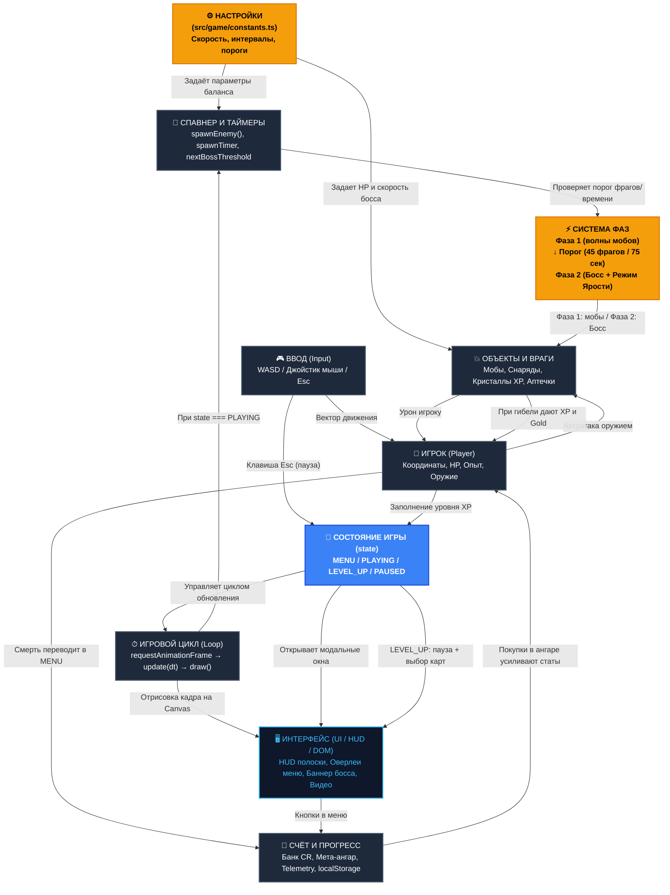

# Cyber Survivors

Браузерная sci-fi аркада на выживание в жанре Survivor / Bullet Heaven.

**Публичная ссылка на игру:** [https://derushbdh.github.io/Vibe-Game/](https://derushbdh.github.io/Vibe-Game/)

---

## 🎮 Идея и геймплей

> Игрок маневрирует по неоновой арене, уничтожая волны кибер-дронов, собирая кристаллы энергии и прокачивая модули корабля, готовясь к столкновению с боссами.

### Ключевые механики:
- **3 класса дронов:** Страж (авто-бластер), Фантом (орбитальные клинки), Техномант (цепная молния Теслы).
- **8 системных модулей:** авто-бластер, клинки, молния, сверхновая с отталкиванием, рикошетный чакрам, турбо-тяга, ядро перегрузки урона и супер-магнит.
- **Ангар и мета-прокачка:** банк кредитов `CR` сохраняется в `localStorage` для постоянных улучшений корпуса.
- **Стабильная сессия на 3–5 минут:** непрерывный сбалансированный бой без зависаний и вылетов с нарастающей сложностью.
- **Полноценная пауза (<kbd>Esc</kbd>):** замирание времени без рассинхронизации дельты кадров и затемнение всего интерфейса.
- **Сбор телеметрии:** панель истории забегов с возможностью экспорта в JSON.

---

## ⚙️ Настройки игры и управление балансом

Все настраиваемые параметры вынесены в единый файл конфигурации:
👉 **[`src/game/constants.ts`](./src/game/constants.ts)**

Любой параметр можно изменить **за 2 минуты** без необходимости искать числа в коде:
1. **Фаза 1 (Обычный бой):**
   - `ENEMY_SPEED_SCALE` — скорость обычных врагов (+25–50% для усложнения);
   - `ENEMY_SPAWN_INTERVAL` — интервал появления врагов (-20–30% для частых волн);
   - `ENEMY_MAX_CAP` — лимит плотности толпы (75).
2. **Порог перехода в Фазу 2:**
   - `PHASE2_TRIGGER_MODE` — выбор режима (`'kills'` по фрагам или `'time'` по секундам);
   - `PHASE2_KILLS_THRESHOLD` — порог убийств для босса (45 фрагов ≈ 50 сек боя);
   - `PHASE2_TIME_THRESHOLD_SEC` — порог времени (75 сек = 1:15).
3. **Фаза 2 (Боссы):**
   - 3 вида боссов: *Кибер-Дредноут* (таранный рывок), *Шторм-Архонт* (аура молний), *Сингулярность Бездны* (грави-пульсары);
   - Полоска здоровья босса отображается **только когда он виден на экране**;
   - При спавне босса срабатывает звуковая сирена и неоновый баннер тревоги.

---

## 🏗 Архитектура проекта

Схема взаимодействия основных компонентов игры:



---

## 🏷 Контроль версий и теги

В репозитории зафиксированы ключевые этапы исследования механик:

- **`phase-v1-time-1m15s`** — Фаза 2 (босс) активируется строго по **таймеру 1:15** (75 сек):
  ```bash
  git checkout phase-v1-time-1m15s
  ```
- **`phase-v2-kill-count-45`** — Фаза 2 (босс) активируется по **45 фрагам** (~50 сек):
  ```bash
  git checkout phase-v2-kill-count-45
  ```
- **`game-constants-config`** (`main`) — актуальная версия с выносом всех настроек в [`src/game/constants.ts`](./src/game/constants.ts):
  ```bash
  git checkout main
  ```

---

## 🕹 Управление

- **Клавиатура:** `W`, `A`, `S`, `D` или стрелочки.
- **Мышь / Тач:** зажмите ЛКМ или палец на экране и ведите (виртуальный экранный джойстик).
- **Пауза:** клавиша <kbd>Esc</kbd> или кнопка «⏸ Пауза» в верхнем HUD.
- **Стрельба:** автоматическая по ближайшим целям.

---

## 🚀 Локальный запуск

```bash
npm install
npm run dev
```

Проверка сборки и TypeScript strict:
```bash
npm run typecheck
npm run build
```
