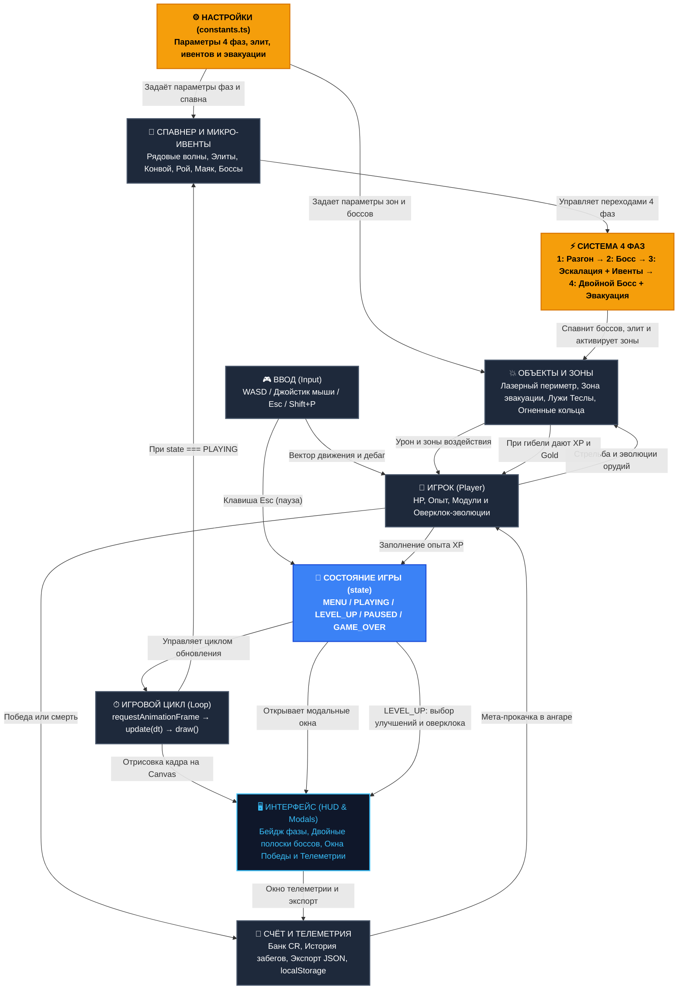

# Cyber Survivors

Браузерная sci-fi аркада на выживание в жанре Survivor / Bullet Heaven.

**Публичная ссылка на игру:** [https://derushbdh.github.io/Vibe-Game/](https://derushbdh.github.io/Vibe-Game/)

---

## 🎮 Идея и геймплей

> Игрок маневрирует по неоновой арене, уничтожая волны кибер-дронов, собирая кристаллы энергии и прокачивая модули корабля, готовясь к столкновению с боссами.

### Ключевые механики:
- **3 класса дронов:** Страж (авто-бластер), Фантом (орбитальные клинки), Техномант (цепная молния Теслы).
- **8 системных модулей и их эволюции [ОВЕРКЛОК]:** авто-бластер (сдвоенный плазмомет), клинки (грави-диск с ударной волной), молния (буря Теслы с лужами), сверхновая (сингулярная заморозка и огонь), рикошетный чакрам (осколочные диски), турбо-тяга (плазменный след), ядро урона (крит x2.0) и супер-магнит (глобальный импульс).
- **Ангар и мета-прокачка:** банк кредитов `CR` сохраняется в `localStorage` для постоянных улучшений корпуса.
- **Геймплейный цикл на 4 фазы (~10 минут):**
  1. *Фаза 1 («Разгон», 0:00–2:30)* — накопление билда, стартовые волны.
  2. *Фаза 2 («Первый рубеж», 2:30–4:00)* — битва с боссом, добыча Ядра Пробуждения, открывающего эволюцию оружия.
  3. *Фаза 3 («Эскалация матрицы», 4:00–7:30)* — элитные дроны, оверклок оружия и 3 микро-ивента («Рой камикадзе», «Грузовой конвой», «Маяк перегрузки»).
  4. *Фаза 4 («Апогей и Эвакуация», 7:30–10:00)* — сужение арены лазерным периметром, бой с двумя боссами подряд и 60-секундное удержание зоны эвакуации.
- **Полноценная пауза (<kbd>Esc</kbd>):** замирание времени без рассинхронизации дельты кадров и затемнение всего интерфейса.
- **Сбор телеметрии:** история забегов с отображением пройденной фазы, исхода (Победа/Поражение), полученных эволюций и возможностью экспорта в JSON.
- **Инструменты тестирования:** `Shift + P` для быстрого перехода по фазам, `K` для проверки экрана поражения.

---

## ⚙️ Настройки игры и управление балансом

Все настраиваемые параметры вынесены в единый файл конфигурации:
👉 **[`src/game/constants.ts`](./src/game/constants.ts)**

Любой параметр можно изменить **за 2 минуты** без необходимости искать числа в коде:
1. **Фаза 1 (Разгон):** `ENEMY_SPEED_SCALE`, `ENEMY_SPAWN_INTERVAL`, `ENEMY_MAX_CAP`.
2. **Переход в Фазу 2:** `PHASE2_TRIGGER_MODE` (`'kills'` / `'time'`), `PHASE2_KILLS_THRESHOLD` (140), `PHASE2_TIME_THRESHOLD_SEC` (150).
3. **Фаза 2 (Босс):** 3 вида боссов (*Кибер-Дредноут*, *Шторм-Архонт*, *Сингулярность Бездны*), звуковая сирена, дроп Ядра Пробуждения (+50 CR).
4. **Фаза 3 (Эскалация и Ивенты):** `PHASE3_ENEMY_SPEED_SCALE` (1.35), `PHASE3_SPAWN_INTERVAL` (850 мс), `PHASE3_ELITE_SPAWN_CHANCE` (12%), `PHASE3_EVENT_INTERVAL_SEC` (45 с).
5. **Переход в Фазу 4:** `PHASE4_TRIGGER_MODE` (`'kills'` / `'time'`), `PHASE4_KILLS_FROM_PHASE3` (280), `PHASE4_TIME_FROM_PHASE3_SEC` (210).
6. **Фаза 4 (Двойной Босс и Эвакуация):** `PHASE4_ENEMY_MAX_CAP` (120), `PHASE4_BOSS_HP_MULT` (1.5), `PHASE4_SECOND_BOSS_DELAY_SEC` (15 с), `PHASE4_ARENA_BORDER_PADDING` (140 px), `PHASE4_EXTRACTION_TIME_SEC` (60 с), `PHASE4_VICTORY_CR_BONUS` (+500 CR).

---

## 🏗 Архитектура проекта

Схема взаимодействия основных компонентов игры:



---

## 🏷 Контроль версий и теги

В репозитории зафиксированы ключевые этапы исследования механик:

- **`phase-v1-time-1m15s`** — Фаза 2 (босс) активируется строго по **таймеру 1:15** (75 сек):
  ```bash
  git checkout phase-v1-time-1m15s
  ```
- **`phase-v2-kill-count-45`** — Фаза 2 (босс) активируется по **45 фрагам** (~50 сек):
  ```bash
  git checkout phase-v2-kill-count-45
  ```
- **`game-constants-config`** (`main`) — актуальная версия с выносом всех настроек в [`src/game/constants.ts`](./src/game/constants.ts):
  ```bash
  git checkout main
  ```

---

## 🕹 Управление

- **Клавиатура:** `W`, `A`, `S`, `D` или стрелочки.
- **Мышь / Тач:** зажмите ЛКМ или палец на экране и ведите (виртуальный экранный джойстик).
- **Пауза:** клавиша <kbd>Esc</kbd> или кнопка «⏸ Пауза» в верхнем HUD.
- **Стрельба:** автоматическая по ближайшим целям.

---

## 🚀 Локальный запуск

```bash
npm install
npm run dev
```

Проверка сборки и TypeScript strict:
```bash
npm run typecheck
npm run build
```
