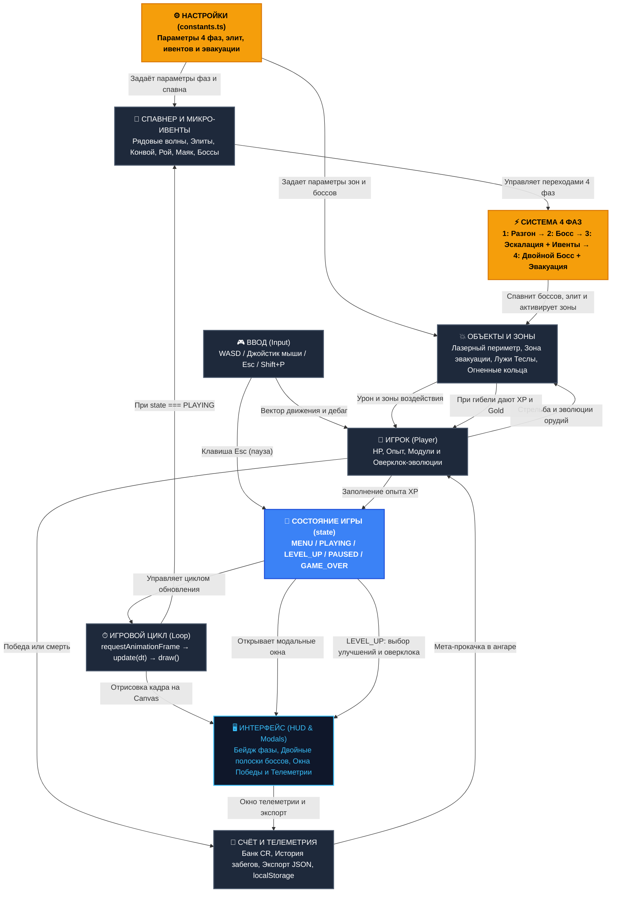

# Cyber Survivors

Браузерная sci-fi аркада на выживание в жанре Survivor / Bullet Heaven.

**Публичная ссылка на игру:** [https://derushbdh.github.io/Vibe-Game/](https://derushbdh.github.io/Vibe-Game/)

---

## 🎮 Идея и геймплей

> Игрок маневрирует по неоновой арене, уничтожая волны кибер-дронов, собирая кристаллы энергии и прокачивая модули корабля, готовясь к столкновению с боссами.

### Ключевые механики:
- **3 класса дронов:** Страж (авто-бластер), Фантом (орбитальные клинки), Техномант (цепная молния Теслы).
- **8 системных модулей и их эволюции [ОВЕРКЛОК]:** авто-бластер (сдвоенный плазмомет), клинки (грави-диск с ударной волной), молния (буря Теслы с лужами), сверхновая (сингулярная заморозка и огонь), рикошетный чакрам (осколочные диски), турбо-тяга (плазменный след), ядро урона (крит x2.0) и супер-магнит (глобальный импульс).
- **Ангар и мета-прокачка:** банк кредитов `CR` сохраняется в `localStorage` для постоянных улучшений корпуса.
- **Геймплейный цикл на 4 последовательные фазы (~10 минут):**
  1. *Фаза 1 («Разгон», 0:00–3:30)* — спокойный сбор базового билда, волны рядовых дронов (цель: 210 убийств).
  2. *Фаза 2 («Первый рубеж», 3:30–5:00)* — звучит сирена, битва с одиночным боссом. Фаза 3 начинается **только после его гибели** и подбора «Ядра Пробуждения» (+50 CR).
  3. *Фаза 3 («Перегрузка и Ивенты», 5:00–8:00)* — открыта эволюция оружия (Оверклок), спавнятся золотые элитные враги, каждые 45 сек происходят динамические события (цель: 420 убийств).
  4. *Фаза 4 («Апогей и Эвакуация», 8:00–10:00)* — сужение арены смертоносным лазером, бой с двумя боссами подряд и 60 секунд обороны центрального круга эвакуации для Победы (+500 CR).
- **Полноценная пауза (<kbd>Esc</kbd>):** замирание времени без рассинхронизации дельты кадров и затемнение интерфейса.
- **Сбор телеметрии:** история забегов с отображением пройденной фазы, исхода (Победа/Поражение), полученных эволюций и кнопкой скачивания отчёта в JSON.
- **Инструменты тестирования:** `Shift + P` для мгновенного переключения фаз, `K` для проверки экрана поражения.

---

## 🎮 Как устроены 4 фазы игры (понятным языком)

Вся 10-минутная сессия построена по синусоиде напряжения: **«Волны → Босс → Волны с ивентами → Финальный штурм и Эвакуация»**.

| Фаза | Название | Когда начинается | Что происходит на экране | Главная цель игрока |
| :--- | :--- | :--- | :--- | :--- |
| **1** | **Разгон** | С первых секунд забега (0:00) | На арену постепенно вылетают рядовые дроны. Вверху в HUD горит синяя плашка: `ФАЗА 1: РАЗГОН (фраги/210)`. | Маневрировать, собирать синие энергокристаллы и прокачать первые 4–5 системных модулей. Набрать **210 убийств**. |
| **2** | **Первый рубеж** | Как только набито **210 фрагов** (или прошло 3:45) | Экран мигает красным, звучит вой тревожной сирены. На арену врывается **один мощный босс** (Кибер-Дредноут, Шторм-Архонт или Сингулярность). Вверху экрана появляется его шкала прочности. | Победить босса. **Внимание:** Фаза 3 начнется **строго в момент гибели босса**! Из него выпадает золотое *«Ядро Пробуждения»* (+50 CR), а взрывная волна раскидывает окружение. |
| **3** | **Перегрузка матрицы** | **Сразу после уничтожения босса Фазы 2** | В HUD загорается фиолетовая плашка `ФАЗА 3: ЭСКАЛАЦИЯ (0/420)`. **Снимается потолок прокачки:** модули 5-го уровня теперь могут мутировать в супер-оружие **[ОВЕРКЛОК]**. В толпе появляются крупные враги с золотой аурой, а каждые 45 сек звучит предупреждение о микро-ивенте (Рой камикадзе, Конвой +80 CR или Зона ускорения). | Прокачать оверклок-модули, перехватывать конвои и уничтожить **420 врагов** внутри этой фазы. |
| **4** | **Апогей и Эвакуация** | Когда набито **420 фрагов в Фазе 3** (или прошло 5:15) | Арену сжимает красный лазерный периметр (за черту заезжать нельзя — сжигает HP). Спавнятся сразу **два финальных босса** подряд. После победы над обоими в центре арены загорается зеленый посадочный круг челнока. | Убить обоих боссов, влететь в зеленый круг и **удерживать позицию 60 секунд**. По истечении таймера — **ПОБЕДА (+500 CR)**! |

---

## ⚙️ Настройки игры и управление балансом

Все балансные параметры и пороги фаз централизованы в файле:
👉 **[`src/game/constants.ts`](./src/game/constants.ts)**

Спавн боссов замедлен в 1.5 раза для комфортного темпа игры:
1. **Фаза 1 (Разгон):** 
   - `PHASE2_KILLS_THRESHOLD = 210` (порог убийств для выхода босса, увеличен в 1.5х со 140);
   - `PHASE2_TIME_THRESHOLD_SEC = 225` (альтернативный таймер — 3 мин 45 сек, увеличен в 1.5х со 150 с);
   - `PHASE2_HARDCORE_KILLS = 135` (порог для хардкор-режима).
2. **Фаза 2 (Босс):** 
   - 3 вида боссов (*Кибер-Дредноут*, *Шторм-Архонт*, *Сингулярность Бездны*), звуковая сирена, дроп Ядра Пробуждения (+50 CR).
3. **Фаза 3 (Эскалация и Ивенты):** 
   - `PHASE3_ENEMY_SPEED_SCALE = 1.35` (+35% к скорости мобов);
   - `PHASE3_SPAWN_INTERVAL = 850` мс (интервал спавна толпы);
   - `PHASE3_ELITE_SPAWN_CHANCE = 0.12` (12% шанс золотой элиты);
   - `PHASE3_EVENT_INTERVAL_SEC = 45` с (периодичность случайных событий);
   - `PHASE4_KILLS_FROM_PHASE3 = 420` (порог фрагов внутри Фазы 3, увеличен в 1.5х с 280);
   - `PHASE4_TIME_FROM_PHASE3_SEC = 315` (или 5 минут 15 сек внутри Фазы 3, увеличено в 1.5х с 210 с).
4. **Фаза 4 (Двойной Босс и Эвакуация):** 
   - `PHASE4_ENEMY_MAX_CAP = 120` (лимит мобов для финала);
   - `PHASE4_BOSS_HP_MULT = 1.5` (множитель стойкости финальных боссов);
   - `PHASE4_SECOND_BOSS_DELAY_SEC = 25` с (задержка выхода 2-го босса, увеличена в 1.5х с 15 с);
   - `PHASE4_ARENA_BORDER_PADDING = 140` px (отступ лазерной рамки арены);
   - `PHASE4_EXTRACTION_TIME_SEC = 60` с (удержание круга эвакуации);
   - `PHASE4_VICTORY_CR_BONUS = 500` CR (награда за победу).

---

## 🏗 Архитектура проекта

Схема взаимодействия основных компонентов игры:



---

## 🏷 Контроль версий и теги

В репозитории зафиксированы ключевые этапы исследования механик:

- **`phase-v1-time-1m15s`** — Фаза 2 (босс) активируется строго по **таймеру 1:15** (75 сек):
  ```bash
  git checkout phase-v1-time-1m15s
  ```
- **`phase-v2-kill-count-45`** — Фаза 2 (босс) активируется по **45 фрагам** (~50 сек):
  ```bash
  git checkout phase-v2-kill-count-45
  ```
- **`game-constants-config`** (`main`) — актуальная версия с выносом всех настроек в [`src/game/constants.ts`](./src/game/constants.ts):
  ```bash
  git checkout main
  ```

---

## 🕹 Управление

- **Клавиатура:** `W`, `A`, `S`, `D` или стрелочки.
- **Мышь / Тач:** зажмите ЛКМ или палец на экране и ведите (виртуальный экранный джойстик).
- **Пауза:** клавиша <kbd>Esc</kbd> или кнопка «⏸ Пауза» в верхнем HUD.
- **Стрельба:** автоматическая по ближайшим целям.

---

## 🚀 Локальный запуск

```bash
npm install
npm run dev
```

Проверка сборки и TypeScript strict:
```bash
npm run typecheck
npm run build
```
